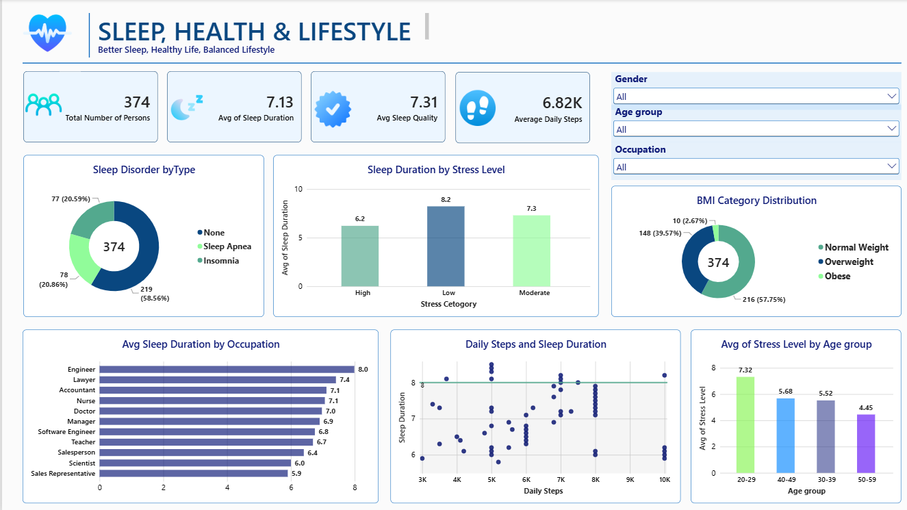

# Sleep, Health & Lifestyle Analysis Dashboard

## Project Overview
This project explores the relationship between sleep, health, and daily lifestyle using Power BI. I built an interactive dashboard to make the data easier to understand and highlight patterns in sleep duration, sleep quality, stress levels, physical activity, and other health-related factors.

## What I Worked On
- Explored sleep and lifestyle patterns across different age groups and occupations.
- Compared stress levels, daily steps, and sleep duration to understand their relationships.
- Used charts, KPI cards, and slicers to make the dashboard interactive and easy to explore.

## Tools Used
- Microsoft Power BI
- Power Query for data preparation and cleaning
- Data visualization and interactive filtering

This is one of my hands-on data analytics projects, where I applied what I have been learning to turn raw data into a clear and useful visual story.

## Dashboard Overview

## Author
**Mohammad Tayyab Mehdi**

Aspiring Data Analyst | Power BI | Excel | SQL
